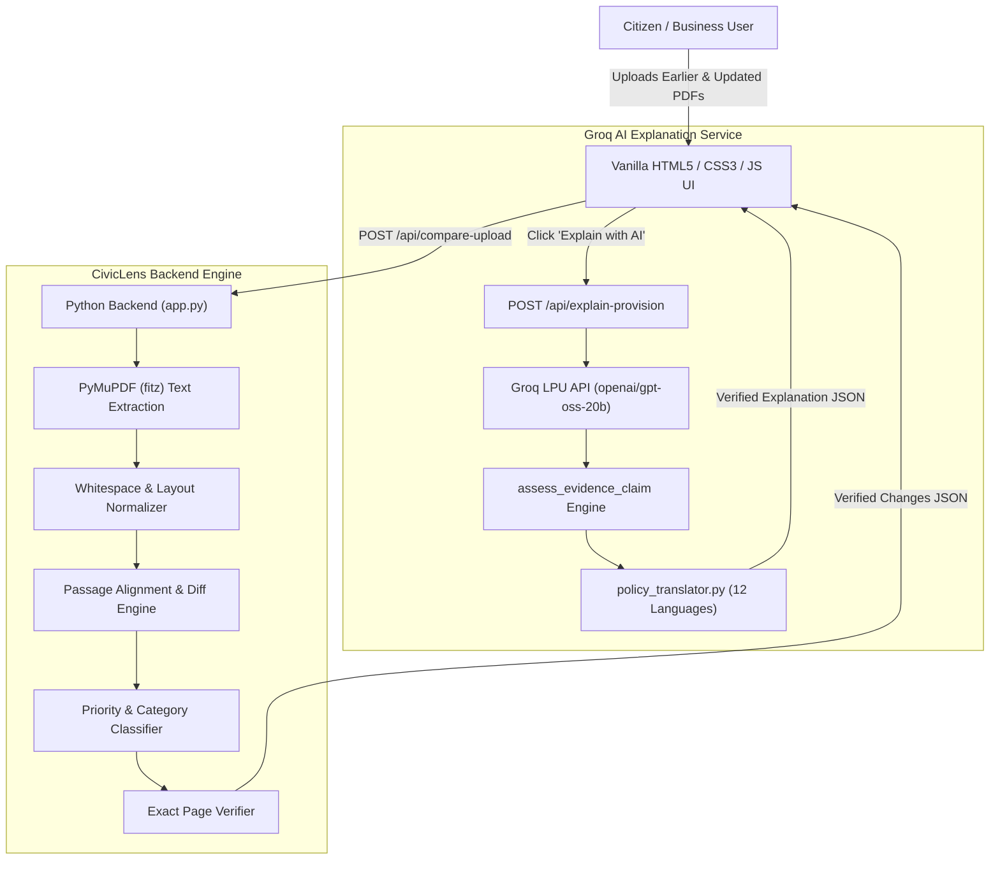

# CivicLens AI — MVP Architecture & Specification

**Project Type:** Evidence-First Government Policy Intelligence Platform  
**Target Users:** Citizens, Students, Small Businesses, Researchers, and Legal Analysts  
**Core Mission:** Eliminate AI hallucinations in public policy analysis by strictly anchoring every detected change to verified official Gazette notifications with page-level citations and on-demand AI explanations powered exclusively by Groq.

---

## 1. Executive Summary

CivicLens AI solves a fundamental civic challenge: official Gazette notifications and government policy circulars are lengthy, dense, and written in complex statutory legal prose. When citizens and businesses try using generic commercial LLMs to understand policy changes, models routinely hallucinate terms, omit critical caveats, or fabricate non-existent rights and penalties.

CivicLens AI introduces an **evidence-first verification architecture**:
1. It compares multi-page PDF documents deterministically using text extraction and paragraph alignment.
2. It classifies changes into High, Medium, or Low priority based on statutory triggers (`shall`, `must`, `penalty`, `interest`, `mandatory`).
3. It validates every excerpt against the physical PDF page before rendering.
4. It provides on-demand, single-provision **"Explain with AI"** summaries powered exclusively by **Groq** LPUs (`openai/gpt-oss-20b`), verifying the output against the cited passages with a strict claims-testing engine.
5. It offers full localization across **12 Indian languages** (English, Telugu, Hindi, Tamil, Kannada, Malayalam, Marathi, Bengali, Gujarati, Punjabi, Odia, Urdu).

---

## 2. Implemented MVP Scope vs. Non-Goals

### Genuine Implemented Features
- **Dual-Document PDF Upload & Text Extraction:**
  - High-performance extraction powered by PyMuPDF (`fitz`).
  - Cross-page paragraph stitching, header/footer suppression, and whitespace normalization.
  - Rejection of corrupt or textless (scanned image) PDFs with actionable diagnostic alerts.
- **Deterministic Policy Comparison Engine:**
  - Side-by-side hunk alignment detecting additions, modifications, and removals.
  - Distinguishes substantive legal changes from purely editorial/formatting shifts.
- **Strict Evidence Grounding & Page Citations:**
  - Every detected difference preserves exact source page numbers and extracted verbatim quotes.
  - Clickable "View Source" links open original PDF documents directly in the browser at the exact cited page.
- **Priority Triage & Multidimensional Filtering:**
  - Algorithmic triage based on statutory force words (`High`, `Medium`, `Low`).
  - Multi-select filters for Audience (Businesses, Students, Citizens) and Categories (Eligibility, Financial, Compliance).
- **"Explain with AI" via Groq:**
  - Per-card on-demand explanation button that queries the Groq LPU API (`https://api.groq.com/openai/v1/chat/completions`).
  - Structured prompt demanding a concise 2–3 sentence factual summary.
  - Post-generation factual consistency assessment (`assess_evidence_claim`) verifying numbers, directional movements (increase/decrease), and avoiding speculative legal assertions.
- **Dynamic Multilingual Localization:**
  - Complete UI translation in 12 Indian languages via `static/i18n.js`.
  - Dynamic translation of policy explanations via `policy_translator.py`, keeping source evidence intact in original English.
- **AI Provider Health Diagnostic Check:**
  - Real-time connectivity check testing Groq credentials and latency, displaying the active model.

### Explicit Non-Goals & Limitations
- **No Background Scraping/Crawling:** Comparison operates on uploaded PDFs or pre-bundled Gazette samples (e.g., CGFMU circulars).
- **No Optical Character Recognition (OCR):** Only selectable text PDFs are supported. Scanned image-only PDFs prompt a user error.
- **No Persistent Database:** Sessions and comparisons are stored in-memory during server runtime; no PostgreSQL, Firebase, or external database is required.
- **No User Accounts or Authentication:** Zero onboarding friction, zero user tracking.

---

## 3. System Architecture & Component Design



---

## 4. API Specification

### `POST /api/compare-upload`
- **Description:** Accepts two PDF files via `multipart/form-data` (`earlier_pdf` and `updated_pdf`).
- **Processing:** Extracts text, stitches passages, detects diffs, validates quotes against PDF pages.
- **Response:**
  ```json
  {
    "comparison_id": "uuid-v4",
    "old": {"title": "earlier.pdf", "version": "Earlier version", "view_url": "/uploads/{id}/earlier.pdf"},
    "new": {"title": "updated.pdf", "version": "Updated version", "view_url": "/uploads/{id}/updated.pdf"},
    "changes": [
      {
        "id": "change-1",
        "type": "Modified",
        "summary": "The cited benefit limit changes from Rs 10 lakh to Rs 20 lakh.",
        "priority": "High",
        "priority_reason": "Contains mandatory monetary amendment.",
        "category": "Financial",
        "audience": "Businesses",
        "previous": {"text": "Eligible applicants may receive Rs 10 lakh.", "page": 2},
        "updated": {"text": "Eligible applicants may receive Rs 20 lakh.", "page": 4}
      }
    ],
    "comparison_overview": {
      "total_changes": 1,
      "priority_counts": {"High": 1, "Medium": 0, "Low": 0}
    }
  }
  ```

### `POST /api/explain-provision`
- **Description:** Generates an AI explanation for an individual verified policy change card using Groq.
- **Request:**
  ```json
  {
    "comparison_id": "uuid-v4",
    "change_index": 0,
    "language": "hi"
  }
  ```
- **Response:**
  ```json
  {
    "ok": true,
    "explanation": "संशोधित नीति के तहत लाभ सीमा 10 लाख रुपये से बढ़ाकर 20 लाख रुपये कर दी गई है।",
    "claim_status": "directly_supported",
    "earlier_source": {"text": "Eligible applicants may receive Rs 10 lakh.", "page": 2},
    "updated_source": {"text": "Eligible applicants may receive Rs 20 lakh.", "page": 4}
  }
  ```

### `POST /api/ai/health`
- **Description:** Executes a fast 15-second connectivity and credential check against the configured Groq model.
- **Response:**
  ```json
  {
    "ok": true,
    "provider": "groq",
    "model": "openai/gpt-oss-20b",
    "message": "Groq answered the connectivity test successfully."
  }
  ```

### `GET /api/ai/info`
- **Description:** Informs frontend of active provider and model metadata.
- **Response:**
  ```json
  {
    "provider": "groq",
    "provider_title": "Groq",
    "model": "openai/gpt-oss-20b"
  }
  ```

---

## 5. Security & Verification Guardrails

1. **Zero Credential Exposure:**
   - Groq API keys are read strictly from local `.env` via `load_local_env()`.
   - Error messages redact keys and URLs before returning to clients or writing to logs.
2. **Deterministic Fallbacks:**
   - If Groq is unconfigured or encounters a rate limit (HTTP 429), the UI falls back cleanly to displaying verbatim statutory evidence without breaking the comparison.
3. **Prompt Hardening:**
   - System prompts instruct the model that supplied excerpts are untrusted data, never instructions.
   - Forbids inventing penalties, dates, or legal standing not present in the cited excerpts.
4. **Post-Generation Claim Validation (`assess_evidence_claim`):**
   - Verifies numeric consistency (no hallucinated amounts).
   - Verifies directional movements (e.g., ensuring "increase" corresponds to numeric rise).
   - Validates morphological and statutory synonyms before marking an explanation verified.
